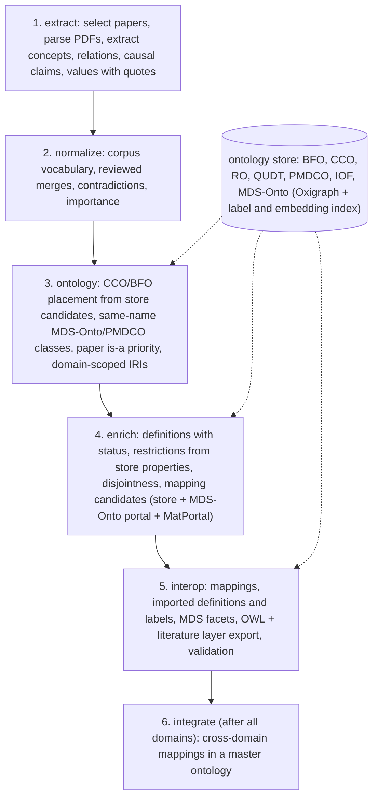

# Knowledge Workflow

Builds draft domain ontologies from curated photovoltaics literature and connects them. For each Zotero collection the pipeline extracts concepts and claims from every paper with verbatim evidence, joins them into a corpus vocabulary, places them under BFO/CCO, enriches and maps them, and exports an OWL ontology plus a literature layer that keeps every claim with its source. A final stage maps the domain ontologies of one run set to each other in a master ontology. The output is a starting point for domain-expert review, not a finished ontology.

## Local dashboard: UCF DPV Knowledge Workflow

The standalone Shiny dashboard wraps the existing pipeline: select Zotero collections across accessible
libraries, assign them to named domains, launch supervised runs, or explore saved domain/integration outputs.
It does not replace the pipeline CLI. Monitoring existing runs is read-only and does not take ownership
of their processes. Dashboard jobs use separate project/attempt folders and their own supervised worker.

After completing the repository setup below, start from the repository root in PowerShell:

```powershell
.\start-dashboard.ps1                    # http://127.0.0.1:8056/
# Optional alternative port:
.\start-dashboard.ps1 -Port 8057
```

The launcher creates a separate dashboard environment under `outputs/dashboard/.venv` only if missing.
It leaves the pipeline environment and any other listener alone. If 8056 is already serving the dashboard,
open that address; do not launch a second process on the same port. Refresh after dashboard updates.

Upload local settings on Home, create a project, and configure domain collections on Zotero ingestion.
Alternatively, use **EXISTING OUTPUTS · READ-ONLY MONITOR** in the top action row to explore saved runs.
Evidence links, lineage, review findings, cropped figures, reports, WebVOWL, search and cited chat are
available without regenerating the corpus. Quote matches and structural validation do not establish
scientific correctness; uncertain/reconstructed links remain identified.

- [Dashboard user and operations guide](dpv_dashboard/README.md): pages, settings, running, monitoring and troubleshooting.
- [Codebase architecture](docs/architecture.md): entry points, module responsibilities, artifacts and extension boundaries.
- [Dashboard verification history](dpv_dashboard/VALIDATION.md) and [third-party notices](dpv_dashboard/THIRD_PARTY.md).

## Pipeline stages

For agent-driven, stepwise operation, start with the [operational codebase ontology](docs/ontology/README.md)
and [agent guide](docs/codebase/agent-guide.md). The [source inventory](docs/codebase/modules.md) links
callables to source locations and hashes; [review findings](docs/codebase/review.md) record known limits.
The ontology's [planning and observation helper](docs/codebase/agent-guide.md#machine-readable-planning-and-saved-run-observations)
can emit bound CLI/dashboard plans and inspect saved runs without executing pipeline work. Its
[usability audit](docs/ontology/usability-review-2026-10-16.md) distinguishes the versioned specification,
recorded completion, available artifacts and scientific review requirements.



| Stage | Command | Agent | Main outputs | Details |
|---|---|---|---|---|
| Extract | `extract` | extraction | `papers/*.json` | [docs/stages/1-extract.md](docs/stages/1-extract.md) |
| Normalize | `normalize` | normalization | `normalized/`, `corpus_report.md` | [docs/stages/2-normalize.md](docs/stages/2-normalize.md) |
| Ontology | `ontology` | ontology | `ontology/classes.json` | [docs/stages/3-ontology.md](docs/stages/3-ontology.md) |
| Enrich | `enrich` | enrichment | `ontology/enriched.json` | [docs/stages/4-enrich.md](docs/stages/4-enrich.md) |
| Interop | `interop` | interoperability | `ontology.ttl`, `domain_layer.ttl`, `ontology_report.md` | [docs/stages/5-interop.md](docs/stages/5-interop.md) |
| Integrate | `integrate` | integration | `integration-*/<domains>.ttl`, `integration_report.md` | [docs/stages/6-integrate.md](docs/stages/6-integrate.md) |
| Ontology store | `ontologies build` | | `outputs/cache/ontology_store/` | [docs/ontology-store.md](docs/ontology-store.md) |
| Reporting | (every stage) | | `run.json`, `eval_runs.csv`, `eval_integrations.csv` | [docs/stages/7-reporting.md](docs/stages/7-reporting.md) |

The stage order is fixed in ordinary Python (`src/run.py`); no model decides what runs next. Each agent has its own prompt and JSON schema (`src/resources/prompts`, `src/resources/schemas`) and writes its artifact before the next stage reads it.

## Setup

```powershell
uv venv
uv pip install --python .venv\Scripts\python.exe -r requirements.txt
Copy-Item .env.example .env   # then add your Zotero, MDS-Onto, MatPortal and model keys
```

Keep Ollama running with the configured local model (`kw-qwen3.5-9b-32k`) and embedding model (`nomic-embed-text`). Build the ontology store once (downloads missing ontology files, the latest MDS-Onto from its portal, and embeds every term; rebuild after a source or embedding-model change):

```powershell
uv run --with-requirements requirements.txt python -m src.run ontologies build
```

Credentials, environments, caches, PDFs and results are excluded from Git.

Runtime caches: successful downstream JSON calls are reused only for the same input, prompt/schema, model,
provider settings and workflow revision. Incomplete row batches and schema echoes are not cached. Reused calls
record zero new compute in the ledger and retain their originating run, item and usage in `calls.jsonl`.
Use a new model name or workflow revision when replacing chat weights under an existing model name.
Embeddings are deduplicated and persisted in `outputs/cache/embeddings.sqlite3`, keyed by endpoint, model,
`EMBED['cache_version']` and text. Bump the cache version when replacing an embedding model under the same name.
Successful empty portal searches expire after one day; failed requests are never cached.
`--limit` stops PDF acquisition as soon as enough ranked, available papers have been found. Extraction packs
adjacent short sections up to 6,000 characters while retaining headings, captions, evidence checks and all text.

## Running

The pipeline uses two independent paper/batch workers by default (`--workers 1` forces serial work).
Chunks within one paper and dependent stages remain ordered. Local chat and embedding requests share
a concurrency limit. Ollama overload/429/503 or out-of-memory errors halve that limit (8 -> 4 -> 2 -> 1)
for the rest of the run; two timeout failures do the same. Failures from requests that were already
running when the limit last changed count once. Transient local requests have two retries with
5/10-second backoff, in addition to the existing JSON and coverage safeguards. The effective limit and
fallback reasons are recorded in `run.json` (or `integration.json`). Already-running requests finish
before the reduced limit governs new requests.

Answers are reused per row across runs: a row whose content is identical to one answered before (same
revision, model, prompt, evidence, support counts, parent, siblings and candidates) takes the earlier
answer, so tea-n10 asks the model only about what changed since tea-n5 (`outputs/cache/rows.sqlite3`;
every run's `rows.jsonl` lists each answer and whether it was reused). `$env:KW_FRESH = "1"` asks the
model for everything. `.\scripts\bench-concurrency.ps1 -FromRun <finished run>` finds how many requests
at once your GPU handles best; `.\scripts\run-checks.ps1` reruns the checks behind the 2026-10-15
revision (reuse across sizes, study stage and domain in one call, first-call answer rates).

For a resilient cumulative sweep across tea, reliability and si-topcon:

```powershell
Set-Location C:\Users\brent\dev\knowledge_workflow
.\scripts\run-sweep.ps1                         # 5, 10, 15, 20, 25; two workers
.\scripts\run-sweep.ps1 -ContinueTo50           # adds 30, 35, 40, 45, 50
.\scripts\run-sweep.ps1 -ContinueTo100          # 5 through 100, in increments of five
.\scripts\run-sweep.ps1 -Workers 1              # force one worker
# Unattended, resuming after crashes (scheduled task setup in the script header):
.\scripts\auto-sweep.ps1 -SweepId 20261005-120000 -Workers 4
# Reuse a previous sweep id to resume completed stages after interruption:
.\scripts\run-sweep.ps1 -SweepId 20261005-120000
```

The script retries transient command failures once with half the workers, records terminal failures and
continues other collections and sizes. Integration includes only successful, structurally valid runs
from the current size; failed-paper runs are excluded and at least two domains are required. A smaller
available corpus is recorded explicitly. Logs and `summary.csv` live in `outputs/sweep-<id>/`.
Exit status is 1 if any run failed, was partial/invalid, or integration was skipped, after attempting
the entire sweep. Uncertain model answers still require review in each run's ontology report.
After all attempts, the script writes `outputs/sweep-<id>/report/report.html`, `report.md`, figures,
and a single-header `sweep_summary.csv`. The report lists failed, partial, invalid and skipped attempts;
plots use completed domains and their selected integrations only. Report-generation failures appear
in the sweep status summary and `report.log` and also produce exit status 1.
Each pipeline run and integration also appends progress to its own `run.log` and warnings/errors to
`warnings_errors.jsonl` (timestamp, run id, stage and redacted message). Repeated search failures and
Python warnings are retained. External search queries over 512 URL-encoded characters are rejected
before requests; malformed oversized concept labels are logged and skipped for portal search while
their original labels and evidence remain unchanged for review.
To rebuild the report without running the pipeline:

```powershell
uv run --with-requirements requirements.txt python -m src.figures `
    --sweep-summary outputs/sweep-YOUR_SWEEP_ID/summary.csv `
    --out outputs/sweep-YOUR_SWEEP_ID/report
```

`script.txt` and `scripts\auto-sweep.ps1` start Ollama with as many request slots as workers and restart
it with fewer slots when the pipeline halves its limit (which frees Ollama's reserved context memory).
By hand: quit the tray application, then in a separate PowerShell window run
`$env:OLLAMA_NUM_PARALLEL = "2"; ollama serve` with the slot count matching `-Workers`.

On a Slurm cluster, `sbatch scripts/slurm-sweep.sh` uses whatever the job is given: every allocated GPU
(as many vLLM copies of the model as fit), workers scaled to the copies, and the domains of each size
side by side. Ask for more with `sbatch --gres=gpu:N ...`; the header lists the overrides.
Run manifests capture hardware/serving setup, and the sweep samples GPU power/utilization every 30
seconds for report totals. See [Slurm setup and compute accounting](docs/slurm-metrics.md) for units,
resume behavior, coverage and missing-counter handling.

```powershell
# one domain, all stages
uv run --with-requirements requirements.txt python -m src.run all --collection tea --limit 5

# three domains, then the cross-domain stage
$cols = "tea","reliability","si-topcon"
foreach ($c in $cols) {
    uv run --with-requirements requirements.txt python -m src.run all --collection $c --limit 5
    if ($LASTEXITCODE -ne 0) { break }
}
if ($LASTEXITCODE -eq 0) { uv run --with-requirements requirements.txt python -m src.run integrate --collections @cols }

# figures and the grouped report (report.md, report.html, sweep_summary.csv) -> outputs/figures/<revision>/
# written automatically after every finished run (<run>/figures/) and integration (<integration>/figures/ and
# outputs/figures/<revision>/); --no-figures skips that
uv run --with-requirements requirements.txt python -m src.figures
uv run --with-requirements requirements.txt python -m src.figures --runs RUN_ID RUN_ID --out outputs/figures/mine

# resume a run (skips completed stages); preflight checks
uv run --with-requirements requirements.txt python -m src.run all --run-id tea-YYYYMMDD-HHMMSS
uv run --with-requirements requirements.txt python -m src.run check --collection tea
```

**Model profiles** (`LLM_PROFILE`, `src/config.py`): `ollama` (default, local tier), `ollama-lora`, `gemini`, `gemini-lite`, `deepseek`, `groq`, `anthropic`. Local-tier profiles split each stage into narrow single-task calls; frontier profiles use one combined call per batch. With `gemini` or `gemini-lite`, extraction and interop stay on Ollama and normalization, ontology and enrichment use Gemini with quota pacing ([GEMINI.md](GEMINI.md), [GEMINI_HYBRID.md](GEMINI_HYBRID.md)). Sampling temperature is left at each provider's default.

## Error checking and validity

What the pipeline checks, and what it does not establish:

- **Evidence.** Every relation, causal claim and measurement carries a quote of at most 20 words. Quotes are checked against the parsed paper (80% of word 3-grams, normalised) and marked `verified`, `unverified` or, after one re-ask, `unevidenced`. A found quote shows the text exists, not that it supports the claim. Unevidenced items never become axioms.
- **Model output.** Every call must return JSON for a fixed schema; one retry, then the pass is skipped and counted. Answers wrapped in a copy of the schema are unwrapped. Rows the model leaves out are sent once more, and coverage is reported per pass, because missing rows otherwise become silent defaults.
- **Deterministic guards.** Unknown ids never become concepts; free-text types map onto a fixed enum; measurements separate property and entity; external terms reach the model only as candidates retrieved from the ontology store, and answers outside them are dropped; placement checks categories, cycles, paper is-a evidence and lexical heads; restrictions must trace to an extracted relation and fit the property's domain and range; mappings claiming identity need matching names, OWL axioms need a matching BFO category, a mapped store term must not be deprecated, and portal terms outside the store (any ontology the MDS-Onto portal or MatPortal hosts) get SKOS mappings only; cross-domain equivalence never joins two classes of one domain.
- **Uncertain items.** What the checks drop or leave unsure is listed item by item in each run's `ontology/uncertain.json` (unresolved relation ends, rows still unanswered after the retry, parent answers that name nothing offered, dropped restrictions with the reason, portal terms missing from the store, screened, downgraded and dropped mappings), with counts in `eval_runs.csv` (`uncertain_*`).
- **Structural validation** of each ontology and of the master ontology (declarations, round trip, cycles, BFO connectivity). It shows the files are well formed, not that their content is correct. No reasoner is run.
- **Provenance and comparability.** Each run records profile, model and tier per agent, corpus hash, workflow revision and per-call compute. Runs are comparable within one revision and profile; model calls are not deterministic, so the same input can give different output.
- **Not established by any of this:** extraction completeness, correctness of definitions, parents and mappings, and agreement with experts. Those need the evaluation protocol (expert review, model-based judging calibrated on a hand-annotated subset).

## Configuration

`src/config.py` holds everything except keys: profiles and routing (`PROFILES`, `AGENT_PROFILES`, `PIPELINE_TIER`, `AGENT_MODELS`), embeddings (`EMBED`), collections (`COLLECTIONS`, `TOP_N_BY_CITATIONS`), ontology store (`ONTOLOGY_SOURCES`, `ONTOLOGY_STORE`, `ONTOLOGY_SEARCH`), portals (`MDS_ONTOLOGIES`, `MATPORTAL`), mapping thresholds (`MAPPING`), integration (`INTEGRATION`), definition policy (`MODEL_DEFINITION_PROFILES`), LoRA data (`LORA`), output IRIs and `WORKFLOW_REVISION`. See [ONTOLOGY_REVISION.md](ONTOLOGY_REVISION.md) for what each revision changed.

## Optional: local model adapter

`python -m src.run lora-data` builds LoRA training data from BFO, CCO and QUDT with the pipeline's own prompts; `src/resources/lora/` has local (WSL2) and Colab training; `python -m src.run lora-eval --model NAME` scores base against adapter. The four evaluation collections are never used as training data.

## History

This repository replaced the earlier `kw/` and Kweave implementations on 2026-10-03; their code remains in Git history (branch `legacy/pre-opus-20261003`).
